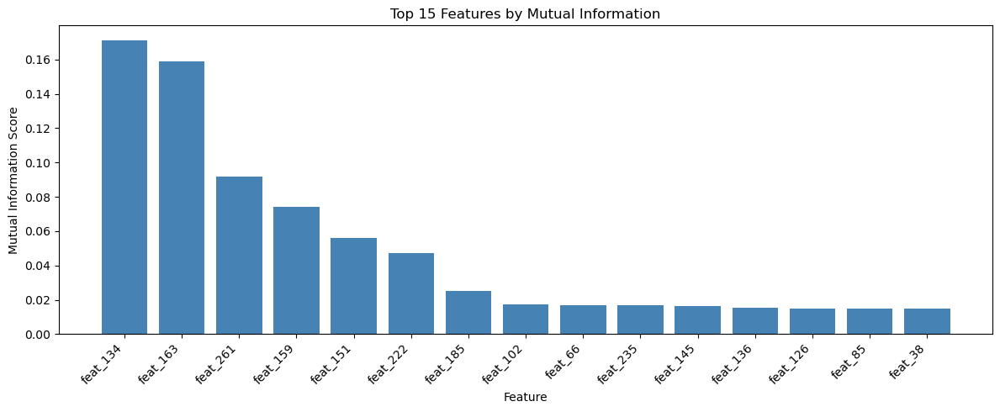
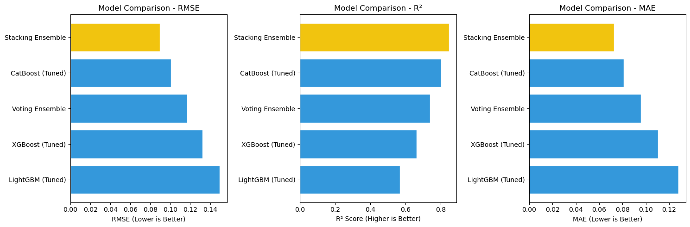
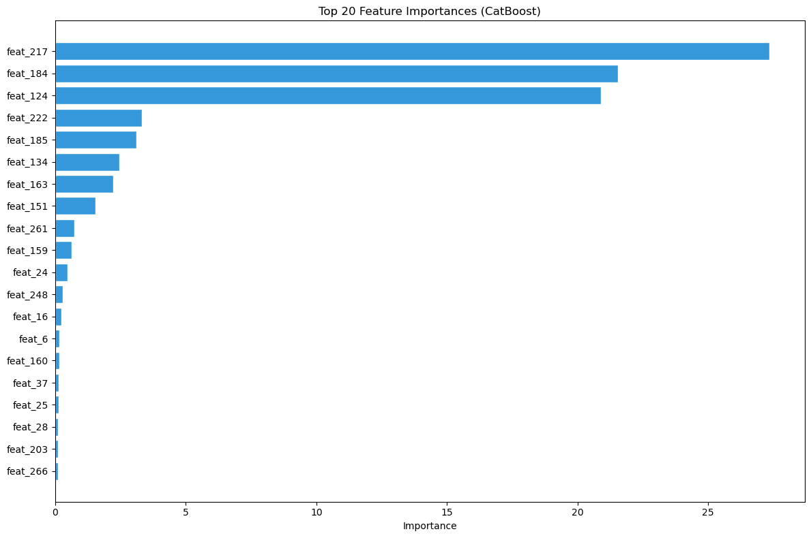
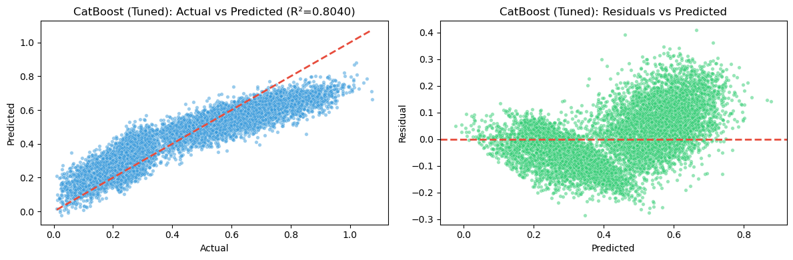
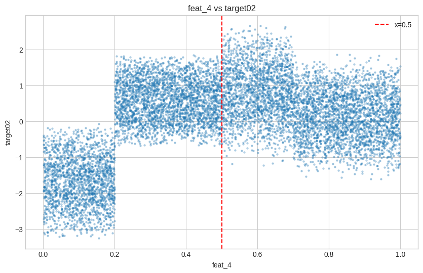
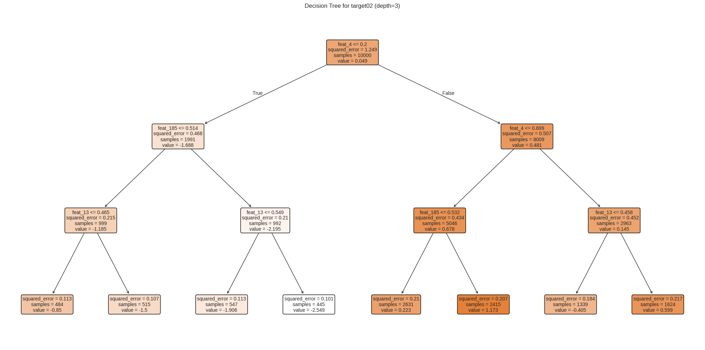
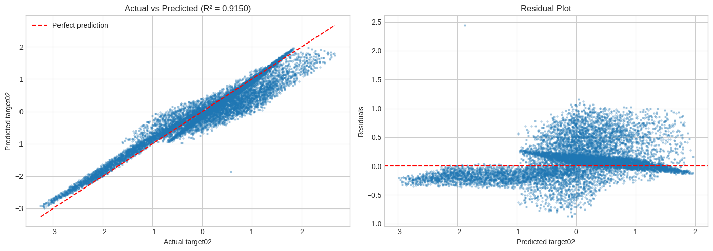

<div align="center">

# Machine Learning Challenge: Stacking Ensemble Regression & Interpretable Rule Discovery

**A two-part ML challenge on 273-feature tabular data. Part 1 uses a gradient-boosting stacking ensemble to reach R² = 0.848 on a target with almost no linear signal. Part 2 reverse-engineers three if-else rules (R² = 0.915) that run on an edge device without any ML library.**

[](#setup)
[](#part-1--high-dimensional-regression-target01)
[](#part-1--high-dimensional-regression-target01)
[](LICENSE)

[📄 Report (PDF)](docs/report.pdf) ·
[📓 Part 1 notebook](notebooks/task1_regression.ipynb) ·
[📓 Part 2 notebook](notebooks/task2_rule_discovery.ipynb) ·
[⚙️ Edge rules](rules/framework_81.py)

*Machine Learning · M.Sc. Artificial Intelligence for Industrial Applications ·
OTH Amberg-Weiden · Prof. Dr. Patrick Levi · Winter Semester 2025/26*

</div>

---

## TL;DR

| Part | Goal | Result |
|---|---|---|
| **1 · Regression** | Predict `target01` from 273 features (10,000 samples) | Stacking ensemble: **R² = 0.848**, RMSE = 0.0897 (5-fold CV), against a linear baseline of R² = 0.047 |
| **2 · Rule discovery** | Find simple rules for `target02` that run without ML libraries | **3 if-else rules on 3 features**, R² = **0.915** |

## The challenge

Each student received an individual dataset: 10,000 training samples with 273 anonymised features (`feat_0` …
`feat_272`), two targets, and 10,000 unlabelled evaluation samples.

- **Part 1:** predict the continuous `target01` as accurately as possible and submit predictions for the
  evaluation set.
- **Part 2:** `target02` is known to depend on only a few features through a few *simple* rules of the form
  `if condition1: calc1 elif condition2: calc2 …`. The rules must run on an edge device that only supports basic
  comparisons and arithmetic, so the deliverable is a filled-in `framework.py` that may not import any extra
  packages.

---

## Part 1 · High-dimensional regression (`target01`)

### Why this is hard
No feature correlates strongly with the target. The largest |r| is **0.168** (`feat_134`), and every mutual
information score is below 0.2. The signal is spread across many features and is mostly non-linear.

<p align="center"></p>

### Approach
1. **Preprocessing:** standardisation inside cross-validation pipelines, so nothing leaks between folds.
2. **Feature selection:** mutual information was checked, but all 273 features were kept, because each one
   carries only a weak signal.
3. **Baselines:** Linear, Ridge and Random Forest models.
4. **Gradient boosting tuned with Optuna:** XGBoost, LightGBM and CatBoost, 30 trials each with 5-fold CV.
5. **Ensembles:**
   - **Voting:** the average of the three boosted models.
   - **Stacking:** XGBoost, LightGBM, CatBoost and Random Forest, combined by a Ridge meta-learner trained on
     out-of-fold predictions. Random Forest adds bagging-based diversity.

### Results (5-fold CV, ranked by RMSE)

| Rank | Model | RMSE ↓ | MAE ↓ | R² ↑ |
|:---:|---|:---:|:---:|:---:|
| 1 | **Stacking ensemble** | **0.0897** | **0.0728** | **0.848** |
| 2 | CatBoost (tuned) | 0.1008 | 0.0809 | 0.804 |
| 3 | Voting ensemble | 0.1171 | 0.0956 | 0.740 |
| 4 | XGBoost (tuned) | 0.1322 | 0.1105 | 0.663 |
| 5 | LightGBM (tuned) | 0.1495 | 0.1279 | 0.569 |
| 6 | Random Forest | 0.2185 | 0.1979 | 0.079 |
| 7 | Ridge / Linear | 0.2223 | 0.1989 | 0.047 |

<p align="center"></p>

**Takeaways**
- Gradient boosting makes the biggest jump: R² rises from 0.05 to between 0.57 and 0.80. CatBoost's ordered
  boosting makes it the strongest single model.
- **Stacking beats voting** (0.848 vs 0.740). A learned weighting outperforms a plain average, which the weaker
  LightGBM drags down.
- **The predictions look like the training target:** a mean of 0.424 against 0.421, and a standard deviation of
  0.247 against 0.228. The predictions go slightly below zero (minimum −0.173) and could be clipped if needed.
- In CatBoost, three features carry about 70 % of the importance: `feat_217` (27.3 %), `feat_184` (21.5 %) and
  `feat_124` (20.9 %). Interestingly, the features with the highest mutual information rank only 6th and 7th.

<p align="center">
  
  
</p>

Deliverable: [`results/EVAL_target01_81.csv`](results/EVAL_target01_81.csv), with 10,000 predictions under the
header `target01`.

---

## Part 2 · Interpretable rule discovery (`target02`)

### Step 1: Which features matter?
Two independent methods agree on the same three features:

| Feature | Correlation with `target02` | Random Forest importance | Role |
|---|:---:|:---:|---|
| `feat_4` | **0.430** | **65.65 %** | *controller*: decides which rule applies |
| `feat_185` | 0.080 | 18.25 % | used in the calculations |
| `feat_13` | 0.034 | 13.04 % | used in the calculations |

Together these three features account for **96.9 %** of the Random Forest importance.

### Step 2: Where are the thresholds?
Plotting `target02` against `feat_4` shows a sharp jump at **0.2** and a second change around **0.7**. A depth-3
decision tree (train R² 0.850, CV R² 0.847, so no overfitting) confirms these splits.

<p align="center">
  
  
</p>

### Step 3: What happens in each region?
A linear regression per region suggests coefficients close to whole numbers. A grid search over
{−2, −1, 0, 1, 2} then compares the candidate rule sets:

| Model | R² |
|---|:---:|
| 2 regions, threshold 0.5 (initial guess) | 0.375 |
| 3 regions, linear-regression coefficients | 0.907 |
| **3 regions, grid-search integer coefficients** | **0.915** |

### Discovered rules

```python
if feat_4 <= 0.2:
    target02 = -2 * feat_185 - feat_13
elif feat_4 <= 0.7:
    target02 =  2 * feat_185 - feat_13
else:
    target02 = -feat_185 + feat_13
```

**R² = 0.915, RMSE = 0.326** on the 10,000 training samples. Running
[`rules/framework_81.py`](rules/framework_81.py) reproduces this exactly. On the evaluation set the regions
contain 2,005 / 4,930 / 3,065 samples (20 % / 49 % / 31 %), in line with the training data.

<p align="center"></p>

The residual plot still has some structure. That suggests the true rules may include a further region or
coefficient the grid search did not cover; see [Limitations](#limitations).

---

## Repository structure

```
.
├── notebooks/
│   ├── task1_regression.ipynb       # Part 1: EDA, baselines, Optuna-tuned boosting, ensembles
│   └── task2_rule_discovery.ipynb   # Part 2: feature ID, thresholds, coefficients, framework
├── rules/
│   └── framework_81.py              # Part 2 deliverable: edge-device rules (numpy/pandas only)
├── results/
│   └── EVAL_target01_81.csv         # Part 1 deliverable: predictions for the evaluation set
├── figures/                         # figures used in this README
├── docs/
│   └── report.pdf                   # project report
├── requirements.txt
├── CITATION.cff
└── LICENSE
```

## Setup

```bash
git clone https://github.com/SomanthaManuranga/Machine-Learning-Challenge.git
cd Machine-Learning-Challenge
python -m venv .venv && source .venv/bin/activate   # Windows: .venv\Scripts\activate
pip install -r requirements.txt
```

**Data:** the challenge datasets were issued per student through the course's Moodle and are not redistributed
here. To re-run the notebooks, put `dataset_81.csv`, `target_81.csv` and `EVAL_81.csv` in `notebooks/`. The
notebooks load them by filename, and `.gitignore` keeps them out of the repository.

## Usage

**Run the edge-device rules** on any CSV with the same 273 feature columns:

```bash
python rules/framework_81.py --eval_file_path path/to/EVAL_81.csv
```

**Reproduce the experiments:** open the notebooks in `notebooks/` and run them from top to bottom. Part 1 includes
3 × 30 Optuna trials with 5-fold CV, so it takes a while on a CPU.

## Limitations

- **Part 1:** single 5-fold CV estimates without repeated CV or confidence intervals. The stacking and voting
  scores come from one CV pass, so no fold-to-fold standard deviation is reported.
- **Part 2:** R² = 0.915 is measured on the training data the rules were derived from, because the evaluation
  targets are hidden. The integer grid only covers {−2, …, 2}, and the remaining structure in the residuals
  suggests the rules are not yet exact.
- The report's text mentions a few numbers from earlier runs (for example a stacking R² of 0.844 and a CatBoost
  R² of 0.782). The values in this README come from the final notebook outputs.

## Tech stack

Python · pandas · NumPy · scikit-learn · XGBoost · LightGBM · CatBoost · Optuna · Matplotlib · Seaborn

## Citation

```bibtex
@misc{manuranga2026mlchallenge,
  author       = {Somantha Manuranga},
  title        = {Machine Learning Challenge: Stacking Ensemble Regression and Interpretable Rule Discovery},
  year         = {2026},
  howpublished = {Machine Learning project, OTH Amberg-Weiden},
  url          = {https://github.com/SomanthaManuranga/Machine-Learning-Challenge}
}
```

## License

Released under the [MIT License](LICENSE). The `framework()` / `cond_eval()` interface in `rules/framework_81.py`
is the course's provided template; the rules are the author's own.
